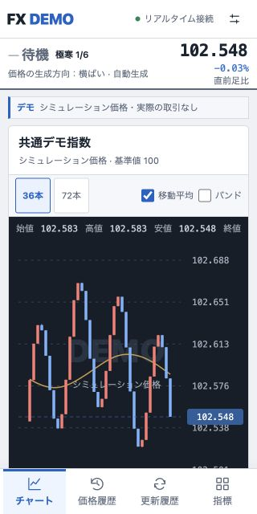
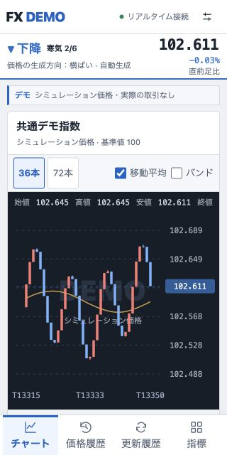
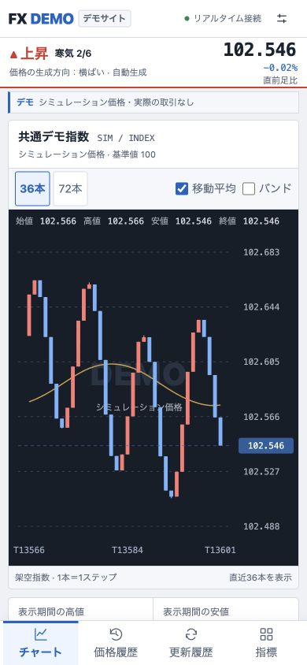
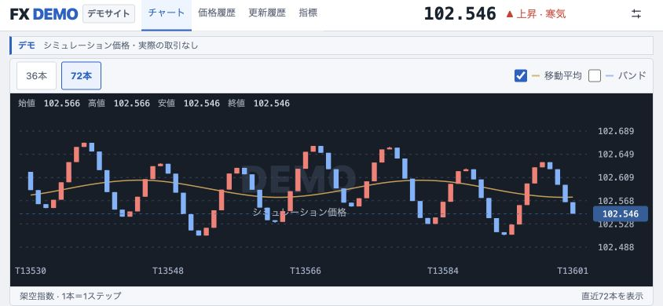

# FX DEMO UI実測・修正レポート

2026年11月6日 / 実ブラウザーでの調査

## 実施範囲

- 開発サイト: https://signal-homepage-1105.maxtakaharu3-4.chatgpt.site/
- 実際に描画されたDOM、`getComputedStyle`、`getBoundingClientRect`、アクセシビリティツリー、コンソールを確認。HTMLの静的読取だけを分析とはしていない。
- 内蔵ブラウザーのビューポートを変更し、320×640、390×844、768×1024、1440×900、844×390、568×320で検証した。iOS/Android実機の検証ではない。
- 確認中、公開設定#0022の自動生成が動作し、価格・ローソク足・シグナルが更新された。シナリオへの指示や停止、データ変更はこのUI調査では行っていない。

## 競合で直接確認した部分

[DMM デモ案内](https://fx.dmm.com/demo/)から[STANDARDログイン画面](https://demotrade.fx.dmm.com/fxcrichpresen/webrich/direct/login)まで実ブラウザーで確認できた。今回は403ではなくログイン画面が表示された。ログイン後のSTANDARD内部は認証が必要なため未確認。アカウント作成や認証回避はしていない。

[DMMの公開USD/JPYチャート](https://fx.dmm.com/market/chart/USDJPY/)では、iframe内の実DOM・Computed Styleまで確認した。これは公開チャートの測定であり、STANDARD内部の寸法として扱わない。

| 部品 | 実測 |
|---|---|
| ローソク足/平均足/ライン選択 | 文字14px・高さ約46.8px・幅120px |
| Bid/Ask選択 | 文字14px・高さ約46.8px・幅97px |
| 最新の足表示 | 文字14px・高さ約46.8px・幅134px |
| 拡大/縮小 | 文字14px・高さ約46.8px・幅78px |
| 表示最適化 | 文字14px・高さ約46.8px・幅120px |
| 期間タブ（1分〜月） | 文字14px・幅75px・高さ68px |
| 操作部の文字・枠 | rgb(7,19,57) |
| 操作ボタン背景 | rgb(237,237,237) |
| フォント | ヒラギノ角ゴ・メイリオ系のシステムフォント |

取り入れたのは、操作部の読みやすい文字、押しやすい高さ、価格とチャートを優先する配置。ロゴ、画像、注文UI、認可情報、ソースコードの転載はしていない。

## 発見した問題と修正

1. **小型スマホで時間軸が固定メニューに隠れる。** 320×640でチャート下端632.7px、メニュー上端583pxを実測。チャート高さを画面高に合わせて調整し、下端約569.9pxまで縮めた。
2. **横向きで現在価格・シグナルの主表示が消える。** 旧CSSは横向き時に右カラムと価格欄を隠すが、844px幅ではスマホのシグナルバーも出なかった。横向き専用の価格・シグナル表示をヘッダーに追加。画面切替も維持した。
3. **読み込み前に保存済みデータと異なる初期チャートを表示する。** 公開サイトの初期描画で97.818を表示し、その後、サーバーの102台の価格へ切り替わることを実ブラウザーで確認。保存データを取得するまでは価格を「—」、チャートを読み込み表示に変更した。失敗時には再同期を表示する。
4. **主要操作の文字が小さい。** DMM公開チャートの14pxを参考に、主要チャート操作を原則14px、高さ44pxへ調整。320px幅は13px、低い横向き画面は12pxで配置を維持する。
5. **スマホの説明文をfont-size:0と疑似要素で置き換えていた。** 読み上げで元の文章と生成文章が重なる状態を確認。表示用の長文/短文を通常のDOMで切り替える方式に修正した。

## 修正後の実測（ローカルUI・公開APIの読み取りのみ使用）

ビューポート変更直後の一時的なSVGサイズを採用せず、SVGのviewBoxが実寸に追いついたことを待って測定した。

| 画面 | ページ横幅 | チャート下端 | 固定メニュー上端/画面下端 | 時間軸 | 主要操作の高さ/文字 |
|---|---:|---:|---:|---|---|
| 320×640 | 320px | 569.9px | 583px | 収まる | 44px / 13px |
| 390×844 | 390px | 715.9px | 787px | 収まる | 44px / 14px |
| 768×1024 | 768px | 638.9px | 1024px（画面下端） | 収まる | 44px / 14px |
| 1440×900 | 1440px | 792.1px | 900px（画面下端） | 収まる | 44px / 14px |
| 844×390 | 844px | 364.1px | 390px（画面下端） | 収まる | 44px / 14px |
| 568×320 | 568px | 260.5px | 263px | 収まる | 44px / 12px |

全6サイズで横スクロールなし、時間軸が表示範囲内、主要チャート操作の高さ44pxを確認した。更新中の価格・足・シグナルはサーバーの共通データのままで、表示設定の変更だけでは公開シナリオは変化しない。

## 操作・コンソール

- スマホ下部の「価格履歴」→「チャート」の切替を実操作し、履歴表とチャートが切り替わることを確認。
- ローカルUIは本番の公開APIを読み取るだけのプレビューで検証。管理操作のPOSTは許可していない。
- 閲覧画面のコンソールに、観測範囲でerror/warnなし。
- 70件の自動テスト、TypeScript検査を通過。追加テストは読み込み前の仮価格非表示と、取得失敗→再同期の復帰を確認する。

## 未確認・制限

- Chrome本体の「表示→開発/管理→デベロッパーツール」は、対象ウインドウを前面にした後もメニューが無効だった。NetworkパネルやElementsパネルを開いて検査できたとは記載しない。今回は実DOM・適用後CSS・コンソールの読み取りAPIを使った。
- Network/HAR、TTFB、CLS、LCPは未測定。改善したという性能数値を作らない。
- 管理画面は所有者ログイン前の表示とログイン導線のみ確認。Google再認証が必要な状態となったため、それ以上進めていない。管理画面内部の実描画は未測定。
- DMM STANDARDのログイン後、DMMのスマホネイティブアプリ、iOS/Android実機は未確認。

## 比較画像

